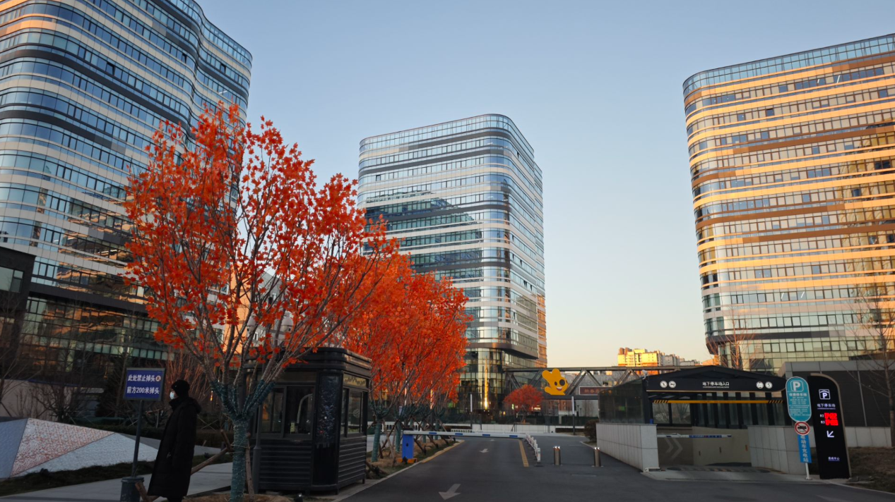
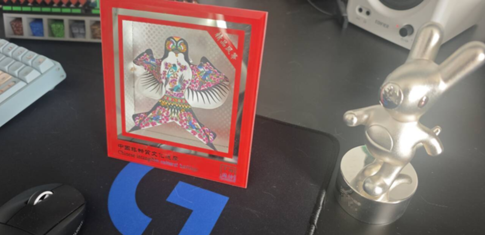
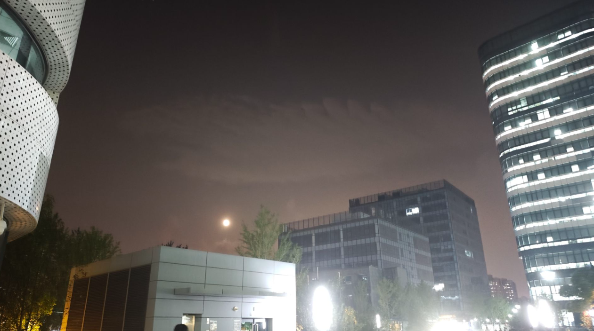
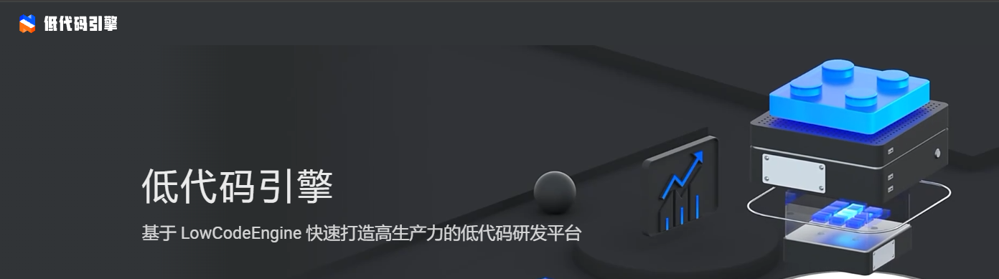
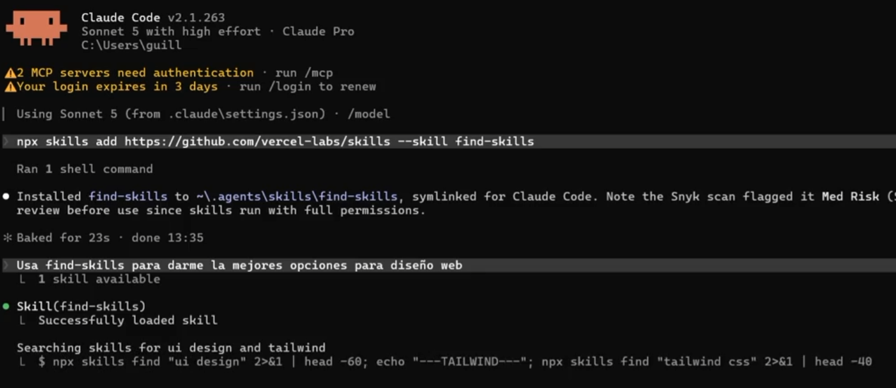
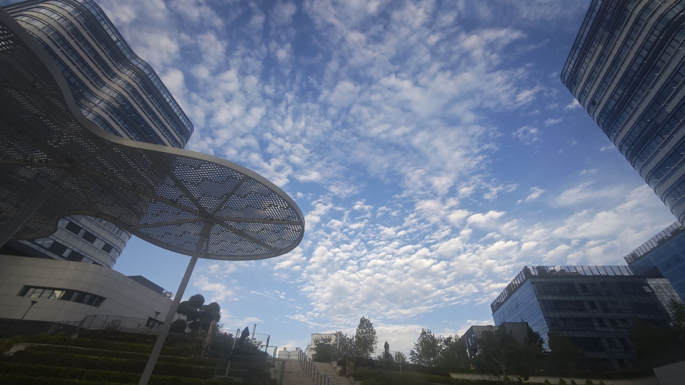

# 困在团里

六年前，一篇《外卖骑手，困在系统里》，让全中国第一次看见了算法与倒计时如何精密地接管千万人的奔跑。

那时候我还没有走进这家公司。和绝大多数旁观者一样，我认为「困」住人的，是跑在服务器里的派单算法、参数与毫秒级路径规划。

直到在这栋写字楼里待了五年多，我才真切体会到：在一家步入中年的互联网巨头里，算法反而是最清晰纯粹的。

 

  
   
  初冬的办公区

北京入冬总是很快。前一周路边的银杏还黄得晃眼，一场北风刮过，枝桠便只剩干干净净的灰白线条。

 

2026 年初冬的一个傍晚，我在工位上准备关掉电脑时，屏幕上正好左右并排停着两个窗口。

左边是黑底白字的终端，旁边挂着公司里一个自发聚起来的内部技术群——CatPaw CLI 群。

消息正以每秒两三条的速度往上滚动，一群素未谋面的工程师在讨论最新 AI 的技术细节，一段一针见血的实测结论刚发出去，几分钟就被点了三十多个赞。

 

右边是一封发出去整整 28 天的正式工作邮件。收件人，是主管，统管整个平台的 L10 负责人和 HRBP。

**邮件里问的是最底线的事情：转岗后我的岗位职责是什么、考核标准是什么。**

算上之前发出的两封，这是第 3 封。3 封邮件，28 天，无任何回复。连同我按最高标准交齐的代码与工程文档，一起沉进了将近一个月的死寂里。

 

桌旁立着一只还没封口的纸箱，以及一个许久未打开的白色上锁的柜子。

五年攒下的东西比我想象中少得多，除了几本没怎么翻过吃灰的技术书和一个用于解压的金黄色的指尖陀螺，柜子里还锁着两样我最后才伸手去拿的小物件。

一个，是两个月前刚满五周年时，公司发给我的「五年银人」纪念袋鼠。底座打磨得很光滑，沉甸甸的，记着我从五年前以 L7 入职、一路写代码升到 L8 的一千八百多个日夜。过去四年，我的绩效单上从未有过低档，拿过多个超出预期，也在去年秋天作为团队主责研发打赢硬仗、捧回过部门级奖项。

另一个，是一只巴掌大的小风筝手办。那是两年前离职的前同事阿风临别放在我桌角的——那时，他在办公区走廊里忍无可忍喊出了「我也是人」，之后没多久就办完了离职，走之前几天的傍晚把这只小风筝摆在我显示器旁，笑了笑说留个念想。此后两年多，我都能想起他和这个微微晃动的风筝。

 

  
   
  风筝和五年纪念银人（家中拍摄）

 

透过工位旁的玻璃窗望向暮色渐沉的北京，回想起五年前我刚入职时，工区走廊的墙上随处可见那八个大字：「既往不恋，纵情向前。」

那时我真心信奉这家公司靠苦活累活杀出来的硬派底色。

可五年之后，同一栋玻璃幕墙大楼里，吹着同一套新风系统的暖气，一边是死磕问题的工程师，另一边却有一个由黑暗织成，让人窒息的「团」。

 

为避免无谓的人身纠葛与商业涉密边界，文中涉及的具体管理者、同事与未公开内部项目均以代号记之。人的姓名不重要，我也无意写一篇情绪上头的控诉，只是想，如果不趁记忆还温热时把这些发生过的事情记录下来，那些奋斗的深夜、凌晨的会议室和荒诞，很快就会像从未发生过一样。

---

## **一、凌晨的 Zoom，与「让业务太舒服了」**

直到今天，只要回想起 2025 年 10 月的那几个星期，我还是会内心泛起波澜。

 

那段时间我们小组正在啃一块直接关系业务和真实转化的艰巨任务，姑且叫它 C 项目。要把一条链路极长、状态盘根错节的核心业务真实流程从头到尾打通贯穿。

扑在上面的核心研发五六个人，我在团队里担技术主负责人。上线前那段日子，群里的讨论，以及线上 Zoom 几乎夜夜持续到很晚。

 

外界一提大厂熬夜，总容易想到被工时赶着走的麻木感。但真正写过生产的人都明白，被迫坐牢式的加班，和五六个小伙伴在同一个攻坚点齐心协力向前推进，这完全是两回事。

「卷」在这里也完全不成立，故意为了增加工时或非理性的内部竞争令人唾弃。而一年中某几个激动人心的时刻，完全为了达成目标自发的努力，是这个时候就跟熬夜打游戏通关黑神话杨戬没什么区别。

 

还清晰记得，到了很晚，大家的嗓子都有一些嘶哑，但 Zoom 里的空气却充满了希望。

有人在排查问题刚刚查出一个藏了三层的异步竞态问题，直接就是「我来投屏！」；最难的整条真实业务链路在联调环境里第一次跑通时，群里和 Zoom 里传来的全是压抑不住的激动。

 

十月底，C 项目稳稳上线，核心指标圆满达成，业务方赞不绝口，很快拿下了部门级奖项。

那天深夜走到凉飕飕的马路上，骨头都在酸，却感觉爽极了。那种靠真本事把复杂难题解掉、被真实世界即时验证的痛快，比任何团建口号都更心潮澎湃。

 

  
   
  晚上的办公区

 

可谁也没想到，两个月后的年底绩效讨论会上，浇下来的却是一盆透心凉水。

 

那天会议室不大，算上当时统管整条平台线、职级高达 L10 美团高管（总监级） L ，屋里一共坐着 6 个人。

按任何一家正常商业公司的常识，下面刚交出一场业务交口称赞的年度标杆，大老板哪怕不庆功，至少也该顺势定定来年的进攻目标。

 

可 L 当着满屋 6 个人的面抛出了一句让空气瞬间凝固的话：

「这次做这么好，反而不是什么好事——让业务太舒服了。」

 

屋里骤然静得连空调出风口的声音都听得见。几个平时打仗最拼的骨干互看了一眼，面面相觑。

L 没有半点开玩笑的意思，紧接着说：「明年大家对业务无需那么发力，不用太配合业务那边。」

这里给大家解释下我们技术和业务的关系。可以简单理解为，业务就是在一线发现用户诉求、痛点，来提需求的，而技术就是落地需求的。举个简单的例子，用户想点外卖时候有自动备注，不想每次都要自己写。产品收集到这个痛点就会提需求给技术去开发落地。

 

散会走出房间，晚上一起吃饭时候，每个人都忍不住问：「为什么反倒成了坏事？」

当时私下里也曾偶有传闻，说 L 与业务侧关系不睦。传闻真假我无从核实，也不妄断；但单从「让业务太舒服了」这几个字里，已经能清晰感觉到那种把内部战友当成博弈对手的气味。

我心里维持了好几年的那层滤镜和信任，从那一刻起裂开了。很长一段时间里，我都在被这个拧巴的难受感侵蚀。

 

在我心里，治理的最高境界是「太上，不知有之」，一流的平台本该像水和电，业务用起来丝滑稳定省心，最好是感觉不到底层有多复杂；

对于纯粹的工程师而言，价值公式很简单：通过技术落地成果，业务成功，公司赚钱，团队值钱。

 

到了 2026 年 7 月，太阳底下的阴影并没有减淡，反而愈加浓厚。

当时，公司进行了一次架构调整：把 L 手里的业务团队全数剥离、划归新的业务技术负责人统筹，只给他留下技术架构相关这几块纯中后台阵地。

可 L 很快在水面之下悄悄接通了一条「地下秘密汇报线」。尽管那些原业务下属在组织架构上已经正式划归新业务老大管理，他依然凭借深耕公司十余年攒下的私交关系网与情绪羁绊：

**不定期挑在周三早上九点到九点半**——趁着大厂工区还没什么人来的最早的时间，悄悄召集这批已剥离的下属开私会**：一边希望他们在业务里继续使用自己这边产出的工具，一边希望他们尽量和新业务团队保持距离感。**

 

组织架构图是画给更高层看的，私底下的江湖人情，自建「小团体」试图脱离组织控制，才是真实运行的现状。

 

**一边想让已经划走到业务的前下属对业务「认清形势，省着用力，能不配合就不配合」，一边又让他们继续往业务里塞自己的 K 工具。**

**对公司业务「不配合」，对自己负责的工具的使用上又猛发力。**

**他从来不反对底下人辛苦，他只反对你替公司和业务辛苦，只允许你替他和汇报辛苦。**

 

九点半关起门来严肃推行「去拖业务后腿」，十点钟推开高管汇报室的门，却能瞬间换上一副面孔，神采飞扬地大谈「AI + 云」与下一代软件工程终局。同一张嘴，两套剧本，在同一栋大楼里切换得丝滑无比。

 

**说到底，真正荒诞的是：美团现在外面仗打得刺刀见红，最高层还在喊着全面拥抱 AI，大楼里却有拿着几百万年薪的 L10，挑着周三清晨工区还没坐满人的半小时，偷偷把已经划走到业务的原下属叫进会议室，苦口婆心地教大家对业务「不配合」「减慢速度」，苦心研究如何让他的技术工具通过感情联系被「主动」使用，从而延续他的「技术底蕴和部门建制」和那可悲的高职级。而丝毫不管公司、业务的死活。**

---

## **二、L10 的技术底蕴，与换皮「造轮子」**

外人如果只看公开场合的 L，很难相信上面那些话会出自他口。

 

刚进公司时候，隔着好几层汇报级差，L 拥有年轻程序员对「极客」的想象：早年写底层 C 语言和客户端代码出身，回忆过自己早期连续奋战清技术债的热血岁月。参加过多个技术沙龙，也频繁站在聚光灯下。

那时候听见和看见这些，第一印象是他是懂底层、有底蕴的技术人。

 

可等我离核心立项和代码仓库真正近了一步之后，才惊讶地发现：最近几年里，L 亲手主推的「看家大作」，几乎每一件都在精准打他自己公开演讲的脸——而且一件比一件离谱。

 

- **第一件，是 2024 年主推的新一代低代码产品，实则耗费巨大人力的套壳换皮。**

2024 年前后，低代码在业界早已高度收敛，外部开源社区里以阿里巴巴开源低代码引擎（ LowCodeEngine ）为代表的工业级底座，协议规范、画布编排与插件机制都已被无数企业反复验证。

如果是专业、为全局着想的技术负责人，面对这种形势一般有两个解法：

一是大方引入，成本低，套一下壳，做好适配交付业务，把省下来的大批高薪人力投向真正卡脖子的其他战场。

二是纯自研，虽然成本高，但是掌握核心技术，后续也方便根据业务调整。

但团队选择了第三个解法：低代码产品被包装成了「自研引擎和架构跃迁」，花费了大量人力，然后又大批 L8、L9 被成建制地填了进去，评审会一场接一场。可但凡看到源码，你瞬间就明白：它本质上就是成熟开源低代码引擎的深度换皮。这种方式对比直接引入开源，业务最终拿到手的效果几乎毫无二致。**最终实现了成本又高又是换皮的尴尬产物。**

 

唯一的区别不在代码里，而在组织里——两三个人干一两个月的开源集成，撑不起 L10 的门面，更撑不起 L10 的述职报告。

  
   
  阿里巴巴开源的低代码引擎

 

- **第二件，动态化跨端容器 R，从 2024 年一路烧到 2026 年，直接亲手制造了一个深不见底的泥潭。**

R 容器套壳 Facebook（脸书） 开源的 RN，把一些外围模块重写，即使是外围模块，重写也是挺费劲的。可恰恰是这份「费劲」，才让整件事显得格外荒诞。

首先是时间窗口与人力账的完全倒挂。最近这三年，正是全球软件工程从移动互联网存量时代剧烈跃迁向 AI 原生开发的黄金三年。就在这决定未来十年技术身位的窗口期里，却把大批顶薪 L8、L9 死死锁在这条封闭容器产线上磨了三年。几千万级的人力投入砸进去，换来了什么决定性的商业增量？答案几乎为零。

其次是做法仍然是热衷套壳，市面上明明已有不少成熟开源、性能优异的跨端现成方案，稍加适配就能跑出同等甚至更稳的落地效果，和基本的工程成本常识大相径庭。

最后是做了好几年依然残缺的工程现实。好几年下来，这套号称「突破天花板」的容器在外部开源社区与行业技术圈里未激起一丝水花；而在公司内部，到了 2026 年，这套框架连常规页面路由跳转和部分容器子节点的循环、条件动态渲染都尚未打通，写一个再普通不过的筛选切换或二级交互，都得靠全局浮层等硬凑。

 

既然生态残缺、开发痛苦，正常业务团队本能地敬而远之，那汇报里光鲜的「核心及出海业务落地案例」是从哪变出来的？

靠 L 动用混迹公司十几年攒下的私交与老关系网，一个个找熟人业务线刷脸硬推进去试点。业务方接了盘，除了平白多背上一套外人改不动、招不到人维护的私有技术债，几乎没有收获实质的商业收益。

**真正有生命力的基础架构，业务方会用脚投票抢着接入；只有战略 ROI 已经归零的轮子，才需要老大端着面子和人情去求熟人「落地案例」。**

 

**最刺眼的反差在同一时间：楼下的业务团队在惨烈的市场肉搏，可楼上这里，十几位高薪 L8、L9 最宝贵的三年光阴，却被持续消耗在一套业务没人愿用的封闭轮子上。**

 

- **第三件，则是 2026 年中仓促上马的旗舰 AI 工具 K，可以称为「彻底失态」。**

2026 年年初，AI 愈演愈烈，那时 L 手里还握着完整的业务地盘，基本没有任何动作。直到年中时候业务线被剥离、危机烧到眉毛，他才火速掉头捡起已经被提议很久的「AI + 云」的大旗，高调转向 AI。

可长期脱离一线手感的人冲进深水区，折腾大半天拿不出真东西，其中一个端上高管汇报桌反复宣讲的拳头智能体 K 工具（照例起了一个听起来颇具异域哲理的拗口名字）。

 

同样的配方，同样的味道，拉下代码一看就什么都明白——本质上，**就是拿海外 OpenAI 开源的 Codex，把一批模块删掉、做一通内部魔改包装，换个名字就成了「下一代的 AI 」。欺负更高层不看源码，玩弄技术两头通吃。**

而且推广方式上，也又回到了熟悉的一个个找关系业务线刷脸硬推进去试点，上文所述的「地下秘密汇报线」，也是这里持续发力的最佳场地。

 

很多人一定会问：三年三代产品，换皮低代码、磨了三年的换壳容器、删改版开源，找到源码半小时就能看明白是怎么回事，为什么他还能年年述职稳稳过关？

 

我认为，业务线的好坏，每天看交易额、看转化、看利润表，造假活不过一个季度；

可技术平台与架构，则裹着厚厚的「术语」，高管不可能亲自下场去 git diff。再加上 L 把一门技术练到了满级——「未来视角吹嘘术」。向上汇报时，他不会多说今天这个工具怎么样、比直接用开源多创造了多少净增量，而可以把镜头拉升到两三年后的「展望」和「终局」上。

把全球大模型实验室与开源社区的全球性成果，不动声色地融进自己的路线图汇报里，**贪天之功据为己有。**

 

**连续三年，从低代码、跨端容器到 AI，次次都是拿阿里、Facebook、OpenAI 现成的免费开源项目换壳改名、故意把简单的事做重来养编制、业务没人用就全靠私下关系硬塞——这早就不是什么试错交学费了。**

 

而且，AI 时代，主流 AI 是用全球开源代码训练出来的。保持开放的团队，每天都在吃 AI 提效的红利；而被塞进这种私有残缺轮子里的业务，不管什么 AI 进来都会被降智。花了公司几千万，不仅没做出任何有含金量的东西，反倒把接盘的业务团队挡在了 AI 提效的门外。

 

如果故事停在这里，我可能和遭遇这些事情的绝大多数人一样叹口气，保持沉默，或者离开。因为毕竟他是部门老大，对公司有损的事情并不能很好的去给谁反馈陈述。

真正把我从这种沉默里敲醒，让我看清了除这些之外，真正的那个黑暗的「团」的，是一次原本再普通不过的内部求助。

---

## **三、从那声「我也是人」说起**

我的前任直属主管 S，正是 L 身边跟了多年的老部下。

S 的管理风格是那种平静时比较正常，但波动时候，则像风暴下的池水 —— 充满各种情绪宣泄与人格打压。

 

那只摆在我桌角两年的小风筝，它的主人阿风，就是团队最早崩开的那一个伤口。

2024 年下半年，在工区七楼去洗手间的走廊旁，S 当着来来往往同事的面，对平时温和客气的阿风高声斥责辱骂，声音大到半层楼都听得清。那天崩溃边缘的阿风，站在走廊里回喊了一句：

**「S 你别这样说话，我也是人！」**

 

风波后不久，阿风便离职了。临走前他把那只小风筝留给了我，此后两年多，风暴却没有随着他的离开而停歇。

2025 年 8 月，仅仅因为一场小范围线上会里的回复不合心意，散会后 S 专门另拉了一场 Zoom 会议，**对着我和另一位同事大声嘶吼、反复反问，羞辱智商与人格。**

那次之后，同场的另一位同事很快离职，我也差点直接走人，只因手头还扛着 C 项目才咬牙留了下来。

 

到了 2026 年春夏，消耗变成了钝刀割肉的日常：她自己拍板定下的方向，做到一半突然喊停、反手贴上「鸡肋」的标签，然后向外开始情绪输出。

长期的窒息与高压很快在身体有了体现。接连患上胆碱能性荨麻疹、神经性皮炎、下颌神经紊乱与反复头痛发烧，跑了医院看了一圈，大夫的结论都很一致：持续精神高压诱发。可当我需要看病请假时，依然屡屡被 S 额外加码材料要求、百般卡扣，有一次向她请假被拒，逼到去越级审批才批了下来。

 

组里几位很优秀的年轻同学也常私下找我叹气，对所做事情的意义感被一点点磨光，萌生去意。

2026 年 8 月中旬的一个周二，我还残留着工程师对规则的最后一分天真。我想，墙上白纸黑字写着「实事求是」「对事不对人」，把这些客观事实按正规渠道向隔级主管 L 和 HRBP H 实名反映——那时候我心里想的是向这位早年写底层代码出身的技术人 L 求助：面对几位同事接连被逼走的事实，总归还会讲一点公道吧？

 

机器确实以惊人的效率转了起来，只是刀口精准对准了提出问题的人。

周二发出实名反馈；仅仅隔了 3 天的周五， L 直接约谈通知要把我强行调离原团队，划去他的另一位直系下属 Y 下 。我当场明确表示不同意。下周一，没有人与我沟通过半句新岗位职责和考核标准，内部系统已经悄无声息地把我一个人划走了。

HRBP H 对辱骂下属与卡扣病假的核心投诉只字未应，轻飘飘将调岗定性为「基于你近期工作状态不佳，从组织角度调整的工作安排」；L 则同步改口为「你无法在调岗前的岗位上按预期工作」。

 

**盯着屏幕上的这行字，我安静了很久。** 一个过去 4 年绩效优良、从未拿过低档、几个月前刚获部门奖的老员工，周二实名反映主管霸凌，周五就被通知单人调离，周一就在书面记录里摇身一变成了「近期工作状态不佳」「无法按预期工作」。

我当即回函追问具体预期是什么、何时传达过、认定依据何在、新岗位职责与考核标准是什么，换来的是一片死寂。

 

那一刻，看着这在短短 72 小时内跑完的清场动作，我才第一次看清了最真实的底层链路：

这里最不需要的就是有独立判断的刺头，最离不开的恰恰是跟了自己多年、对上绝对服从、对下能高压堵住所有杂音的下属，和形成的这个黑暗的「团」。

 

**我去向 L 求助，却不知无意间动了这个黑暗的「团」。指出房间里有臭味的人，立即会被鉴定为嗅觉失常。**

 

看穿部门内部早已官官相护，我在被强行调岗的当天，整理好 16 项完整证据，向公司独立的廉正通道递交了实名举报，成了团队里唯一试图跳出内部这个黑暗的「团」的人。

原以为跨出部门能等来一场独立核查，随后几天密集落下的这三波动作，却让我亲眼见识了关系网跑得有多快。

 

第一波是考勤与交接的突袭逼签。举报刚交上去没几天，HRBP H 突然倒查我近三个月考勤，递来一份打印好的谈话记录要求签字——里面竟把正常的午休时段算进了「离岗时长」，还歪曲成了抗拒交接。我当场拒签，逐条提交了书面异议。

第二波是「多人联动」。九月初的傍晚，本该回避的 HRBP H 把我拉进会议室，身旁多出了一名陌生女性。我礼貌询问她的姓名和所属部门，对方当场拒绝透露，并且明言在公司内部通讯录里根本搜不到她的身份。这位连名字都不肯亮的隐身人，坐下来开口第一句就是：「希望你能不举报，则不举报。」紧接着单方声称，据其了解调查人员问过离职前同事，都没承认被辱骂；一旁的 H 则顺势劝我把举报撤回。我一字未改，平静拒绝了。

第三波来得最快，就在拒绝的第二天——一个周五的下班前。

调入新主管 Y 组的开始几天，我从未向 Y 提过关于「举报」的事，只想着先把交接搞定。Y 最初也明确说过，这个探索任务优先级不高、按我自己的节奏推进即可。

**可就在我拒绝撤回举报的第二天，** Y 突然在工作群里画风大变，连续否定前期产出，扣上「一周就弄个文档，没法交待的」「挑衅我是吧」的帽子，紧接着在我半个字没向他提过举报的情况下，脱口甩出了那句彻底露馅的二选一威胁：

「你想清楚要不要把我卷进来。」

「要么把页面做了别加戏别弄虚作假，要么把我卷进来，把前一周详细的工作记录交给我。」

 

一个我从未告知过举报半个字的新主管，何以在劝撤次日精准说出「把我卷进来」？究竟是谁提前通了气？

答案不言自明，在 L、原主管 S、新主管 Y 与 HRBP H 严丝合缝咬合而成的「团」里，私下通气永远跑得比正式调查快十倍——你以为自己按响了独立的举报按钮，其实收到举报的处理人正是我举报的那个「团」的成员。

 

**在这个「团」里所谓的 HRBP 和内部反馈机制，在这里根本不是解决问题的，纯粹是给这个「团」看家护院、帮着霸凌者一块儿捂嘴、擦屁股的工具。**

 

我现在依然坚信，公司内的大部分 HRBP 和同学都是正常的，不在这种「团」里，也希望大家永远不会遇到这种「团」。

---

## **四、围剿，与死寂**

在这种全力围剿下，我能做的就只剩坚持：一边等集团独立通道的核查结论，一边把每天的任务做到无可挑剔。

 

可随后的九月与十月，风暴依然愈演愈烈，迎面而来的是「无标准」施压 —— 堪称教科书级。

调岗后的两个多月里，我先后发出三封正式书面邮件，请求明确：**新岗位的职责说明、绩效考核的具体标准。**

三封邮件，全部石沉大海。

 

道理很浅显：**标准一旦落到白纸黑字上，考核能核对；只有把标准永远藏起来，才能随时宣布你不达标。**

 

一边对书面标准装死，另一边却继续组合拳。

页面范围和交付标准什么都还没有，Y 已经连续砸下「没有完成工作的基本能力或者意愿」「不胜任工作」「校招实习生一天也能生成几个」的评语，短短两个工作日内三次拿「工作弄虚作假触碰公司诚信红线」施压——可当我两次冷静追问，所谓弄虚作假，究竟对应哪一天、哪一条事实依据时，对面立刻装聋不答。

 

**他们等的是我心态崩盘在群里争吵，刚好坐实「不胜任」。**

 

哪怕明知这是一场命题作文式的样板间消耗，我还是选了最笨和最硬的回应：不吵架，只认结果和产出，把这些刁难，产出到谁也挑不出刺为止。

首轮交付，我把 5 个复杂业务页面从零到一全部跑了出来；为了堵死「凭感觉挑刺」的空间，我自己设计了一套完整指标，通过指标来验证一致性。但对方依然视而不见，丝毫不管这些指标，**纯凭肉眼甩出「细节还原太低，基本无法交互」「大概两小时就能做到你这样」的主观差评。**

 

我依然没在群里争吵。我把终版代码与文档发在群里，并加上一句「页面都已完成，接下来安排什么工作，请明确范围、标准与排期」。

整栋楼仿佛在这一秒被按下了静音键。

从十月下旬到十一月下旬，整整四周——将近一个月的时间里，原本天天挑刺定性的主管 Y、同链条的验收人、隔级 L、HRBP H，没有一个人再回哪怕一个字，三封标准邮件也均无回复；而另一头，我实名递交出去近三个月的那份举报，依然迟迟没有等来一纸结论。

 

**说起来挺讽刺的。楼外的骑手超时一分钟，系统就会立刻弹窗扣款；可在这栋楼里，三封问岗位职责的正式邮件 28 天没人回，16 项证据的实名举报快三个月没有结论，却没有一个环节会超时告警。在这里，最基本的回避和举报保护都可以形同虚设。**

 

赫希曼在《退出、呼吁与忠诚》里讲过：当一个组织开始局部衰退时，成员只有两条路——沉默离开的「退出」，或冒着摩擦风险站出来指出病灶的「呼吁」。真正肯费力气发出「呼吁」的，往往反而是对这家公司怀有最深眷恋与忠诚的人；早就心冷混日子的人，压根懒得较真。

可当一个抱团闭环让全组几十双眼睛清清楚楚看见：提问题的人如何在三天内被单人调岗、被贴标签、被晾进四周的死寂里，整个部门从此就安静了下来。逆向淘汰就此大功告成——有的人迅速学会闭嘴和「拖业务后腿」，有的人则默默退场。

 

**当你的交付干净到对方连一根刺都挑不出来时，他们最后的武器只剩装死。他们赢不了你的代码，你也叫不醒一群装睡的人。**

 

走到这一步，结合前两章的事情，这个「团」的轮廓愈发的清晰了。

正因为事上全靠换壳吹嘘——低代码换皮、容器换皮、AI 工具 Codex 冒充换皮，周三早九点偷拉前下属叮嘱「别配合业务」——这个靠专业根本立不住，只能靠拿捏住「人」来托底。

所以把同事骂到喊「我也是人」的「团」内忠心的下属必须死保，敢提真问题的人则必须尽快踢走。

 

**事上经不起较真，人上就容不下真话。**

---

## **五、黑底白字的微光，与「上下文」的尊严**

如果这五年的故事只写到这里，那未免太灰冷了，也太对不起这一千八百多个日夜，对不起这栋大楼里绝大多数我真心敬重的同事们。

在被孤立调岗、被无端扣帽子、在四周死寂里独自对着屏幕的那些日子里，每天真正能让紧绷的肩背松弛下来、让我重新觉得做一名程序员依然很幸福的时刻，是把视线移回屏幕左侧，切进黑底白字的终端，点开那个 CatPaw CLI 群的瞬间。

那大概是我在这家公司五年里，最喜欢、也最舍不得退出的一个群。

 

它之所以迷人，首先在于它的出身，用哈耶克的话说，它是从一线工程师的指尖底下完完全全自发生长出来的秩序。

为什么偏偏是 CLI （命令行）成了一道天然的筛选？

因为到了 2026 年，拿着精美汇报在周会上空谈「智能体赋能范式」很容易，但真正愿意每天泡在终端窗口里，跟 Agent 、各种 AI 死磕的人，一定是在一线亲手搬砖、对工程硬边界有真切痛感的真正技术人。

  
   
  Claude Code 的运行界面

 

那个群里的空气，干净得像深秋清晨的风。

 

群里大家聊得最密集、碰撞最深的话题，是 **Context（上下文）** 的工程艺术 （上下文是你在让 AI 做判断之前，喂给它的全部前情提要与事实依据）。我至今清晰记得一次很精彩的讨论：当时 Codex 刚刚迭代了最新的上下文管理思路，底层策略发生了一次关键转向——从早期依赖模型对历史长对话做「AI 摘要压缩」，改为了更克制、更尊重原始现场的「上下文裁剪配合」。

消息刚一出来，群里瞬间像烧开的水一样沸腾了。来自不同业务线、平时素未谋面的工程师们纷纷冒出来，讨论效果、预测对比。我还记得有人说过：传统压缩出摘要看似省了窗口，但经过模型层层转述概括之后，最关键的细节、依赖和约束往往会在压缩中失真，最后就会放大幻觉；保留部分上下文、配合裁剪策略，效果会更好。

那些消息往往发出去不到几分钟，消息下方就自发滚出了几十个赞。没有领导领掌，全凭逻辑本身的锋利赢来的几十个赞。

 

平时大家在群里也毫不客气地吐槽公司自研的大模型龙猫 LongCat，吐槽它写代码笨、理解力翻车，段子一个接一个；可只要细读那些吐槽的背后，就能一眼看穿那份嘴硬心软——字里行间哪有一丝幸灾乐祸，满满的全是恨铁不成钢的焦急与期盼。

群里还聚着一批脑子极活络的人才，比如各种高仿 "马斯克"，"TIBO"，在群里仿佛能看到全世界的名人出来发表言论。每逢海内外模型圈深夜放出重磅更新，群友总能第一时间甩出实测对比与效果评测……

在那个窗口里，没人打听你是刚入职的校招新人还是工龄十年的资深专家，也没人在乎你是谁。观点见真章，上下文见高低。

 

从死气沉沉的管理群切回热气腾腾的 CatPaw CLI 群，看着这一冷一热两个屏幕 ——

**原来一家庞大公司局部生病的过程，本质上就是它的组织「Context（上下文）」被中间层蓄意污染与裁剪的过程。**

 

在 CLI 里，每一个优秀的工程师都对上下文怀有敬畏之心，宁肯费力气做精准裁剪，也绝不容忍失真的「美化、扭曲的压缩」。

计算机科学中的经典原则：垃圾进，垃圾出（Garbage in, garbage out）。哪怕底层换上全世界最聪明的模型，只要喂给它的前置上下文被偷偷抹掉了关键事实、塞进了伪造的前提，它算出来的结论就注定是一场幻觉。

 

可走出 CLI，在这些黑暗的「团」里，一些人赖以安身立命的核心，恰恰就是反向操弄组织的上下文：

向上面对最高决策层时，他们做的是极致的「美化」—— 抹去成熟开源底座的出处，折叠那些耗费三年的沉没成本，把全球 AI 行业共同推高的技术前沿能力，美化成自己一页页金光闪闪的汇报；

向下面对指出问题的普通员工时，他们祭出的是冷酷的「上下文裁剪」——把你过去四年与打赢的历史一刀裁掉，把实名投诉直属主管霸凌的前置起因一刀裁掉，把不给标准便倒推 Deadline 的过程一刀裁掉，只留下裁剪后的「不胜任工作」评价，与漫长的静默。

 

好在，CatPaw CLI 群里那几十个无需动员的赞，像北方深冬厚厚冰层底下依然奔涌的暗河，一遍遍无声地提醒着我：

原来我最初向往的那群技术人并没有死。那些凌晨三点在 Zoom 里哑着嗓子打穿 C 项目全链路的战友，那些在命令行里为了一点点真实生产力跃迁而眼睛发亮的同行，才是托举着这只黄色袋鼠穿过风浪、服务亿万用户的真正脊梁。

---

## **尾声：走出那个团，把风还给风筝**

十一月下旬的那个下午，北京的天空无比湛蓝，点缀着点点云彩，透着北方初冬特有的干爽与清冽。

 

在那场将近一个月的绝对静默之后，看着三封石沉大海的邮件与迟迟未见结论的举报，这段拉扯了整个秋天的消耗终于走到了终点。我收拾好工位，把刚领两个月的「五年银人」和阿风留下的小风筝手办一并装进包里，刷卡走出了那扇被我打开了五年的门。

 

  
   
  初冬的北京天空

 

走出大楼站在阳光底下的那一刻，初冬的冷风灌进衣领，前几个月在楼里反复发作的红疹、下颌紧绷与隐隐头痛，深吸一口没有隔温层的冷气，忽然间就松快了。

 

要好的朋友约我喝咖啡，问我这五年最后以这样的方式转身离开，心里会不会觉得委屈，或者后悔八月那个周二多管闲事发出了那封实名反馈？

我端着杯子想了想，很坦然地摇了摇头。一点也不后悔。这五年里，我在真实的复杂业务战场上练硬了自己的技术，体会过打穿全流程的纯粹快乐，也在最后两个月极度严苛的逆风局里，验证了自己不靠任何水分、纯凭技术硬指标把交付做到无可挑剔的定力。那些长在自己身上的本事、判断力，没有任何人能从我身上调走或裁剪掉。

 

回到家那天晚上，我把「五年银人」收进书柜，把那只巴掌大的小风筝手办重新摆在了私人书桌的显示器旁，紧挨着它的是一块亮起光标的 AI 终端窗口。

端详着那只小风筝，我回想起阿风在七楼走廊喊出「我也是人」之后的往日种种。风筝这种东西，看着好像悬在半空，可只要那根看不见的线还死死攥在底下人的手里，它就永远飞不出那个小圈子划定的半径——顺着他的风向，你只能在底下打转；逆着他的心意，他一扯线就能把你拽进泥里。唯有松开那根线的一刻，整片旷野的风才真正属于风筝自己。

 

「飘风不终朝，骤雨不终日」

在手写代码与信息黑箱的旧周期里，靠着话术包装、囤积人头与抱团互保砌起来的「团」看似上下无敌；

但我们正站在 2026 年的岁末——AI 的浪潮与开放的真火正在以十倍速重塑一切，所有背离真实价值的沙堡都不需要谁去推倒，时代自己会完成清算。

 

每逢系统发生严重故障，合格的工程师从不满足于只限于告警消失，问题修复，还会写一份 COE （事故复盘）。

写下最后这一行，便是我对过去五年最体面的告别，也是向这段青春交出的最后一次 git commit。

 

谨以此文，送给当年在 C 项目里并肩熬过夜的战友，送给 CatPaw CLI 群里像「马斯克」「TIBO」那样敏锐坦率的同学们，也送给每一个此刻依然坐在屏幕前认真对待每一句 Prompt、每一行代码、每一份干净上下文的普通工程师。

愿你们保重身体、守住锋芒，永远不必学会「故意不配合」。

愿那只黄色的袋鼠终能抖落背上的铁锈，继续纵情向前；也愿每一个认真做事的人，都不再困在团里。
